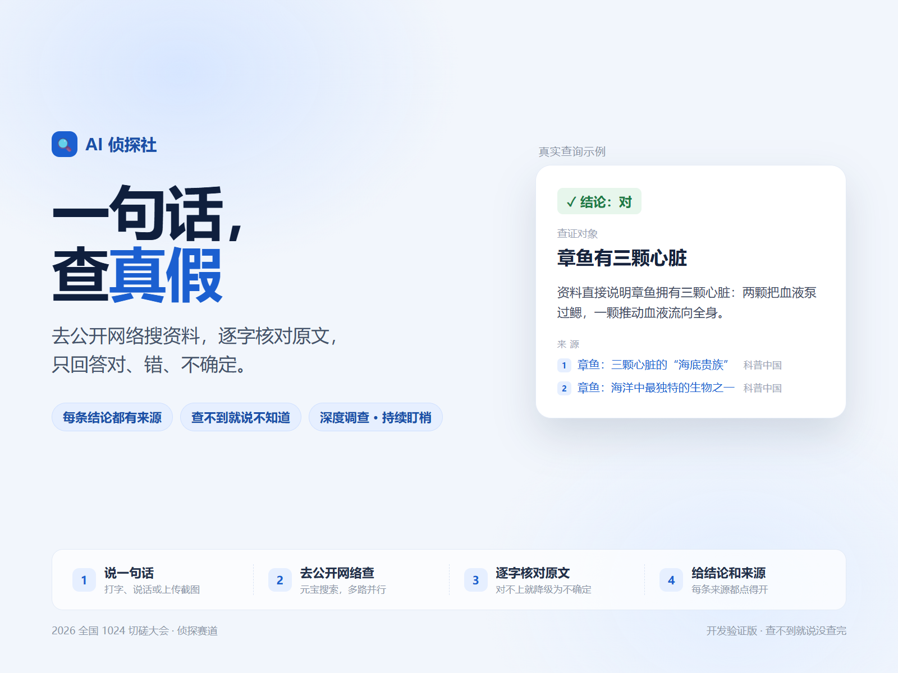
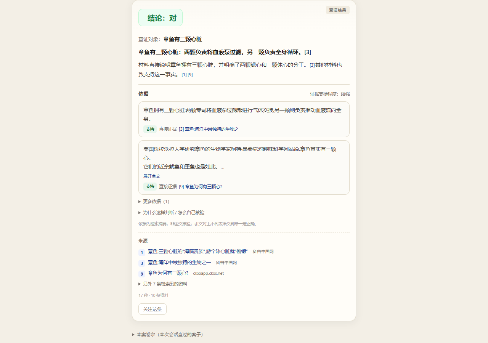

# AI 侦探社 · 一句话查真假

输入一条可疑说法，它先去公开网络搜资料，再逐字核对原文，最后只回答 **对 / 错 / 不确定**，并把点得开的来源摆在下面。查不到、搜不通、模型忙时，它明确说「这次没查完」，不硬判。

- 在线体验：<https://ai-evidence-detective.app.workbuddy.host/?sharecode=EXEUTUUU6C>
- 参赛：2026 全国 1024 切磋大会 · 侦探赛道（主题：查得到，信得过）





---

## 它解决什么问题

群聊转发、短视频「科普」、广告话术里，很多说法听着像真的。直接问大模型，它容易顺着你说；只给搜索引擎，它给一堆结果却不告诉你这句话到底成不成立。这个作品夹在中间：**先搜，再核对，最后才给结论**。

- 结论只有三种：**对 / 错 / 不确定**，另有独立的 **未完成** 状态
- 每条结论下面给出「依据原句」和来源，来源按政府 / 权威媒体 / 一般站点分级
- 模型选出的原句必须能在抓到的资料里逐字找到，对不上就降级为「不确定」

## 两种模式怎么选

| | 快速查证 | 深度调查 |
|---|---|---|
| 检索 | 单轮搜索，约 10 条资料；全是营销站时定向补搜权威站点 | 把主张拆成「原话 / 机构说明 / 条件与反证」三个角度并行搜，最多补搜 2 次 |
| 核对 | 一次判断 + 逐字引文核对 | 同上，另加疑似重复来源检测、域名分布、信源等级 |
| 结果 | 查证卡：结论、一句理由、依据原句、来源 | 调查报告：结论、证据链、每轮检索记录、重复来源 |
| 耗时 | 约 10–20 秒 | 约 30–90 秒（随网络与模型负载变化） |
| 什么时候用 | 一句话能说清的家常说法，想马上知道真假 | 有争议、要找反证、结论要拿去引用 |

两种模式**共用同一套判定规则**：都要有逐字对得上的原句，也都遵循「证据不够就说没查完」。深度调查的差别是检索范围更广、过程可以审计，不是更容易下结论。

拿不准就先跑快速；快速只给出「不确定」，再切深度多找几个角度。

## 三种结论 + 未完成

| 状态 | 含义 |
|---|---|
| 对 | 找到逐字对得上的资料，且证据支持该说法 |
| 错 | 找到逐字对得上的资料，且资料否定该说法 |
| 不确定 | 资料之间存在冲突，或只有间接证据，或引文核对没通过 |
| 未完成 | 搜索失败、资料不足、模型限流 / 超时 / 输出格式异常。**不当作任何结论** |

未完成会按原因给不同提示：限流排队（带剩余秒数）、并发繁忙、搜索失败、部分检索失败、资料长度超限、输出格式异常、演示模式。

## 怎么做到不瞎编

- **引文反查**：模型只负责从给定材料里选证据、给结论；选出的原句由程序回到原文逐字比对，对不上就降级
- **来源分级**：`.gov.cn` / 权威媒体 / 一般站点 / 内容农场分层，农场站降权
- **证据门槛**：必要证据缺失时不给「对 / 错」，改判「不确定」
- **算术校验**：纯数字等式（如 `1=2`）由程序精确计算，不交给模型口算
- **过程可审计**：深度调查把每个检索角度、命中条数、疑似重复来源都放在页面上

## 快速开始

需要 Python 3.11+。

```bash
pip install -r requirements.txt
cp .env.example .env        # Windows: copy .env.example .env
# 编辑 .env，填入腾讯云密钥与大模型 Key
python app.py
```

打开 <http://127.0.0.1:8000>。Windows 也可以直接双击 `start.bat`，它会自动建虚拟环境并装依赖。

没有密钥想先看界面？在 `.env` 里设 `USE_MOCK=1`，会用假数据跑通全流程。

## 环境变量

| 变量 | 说明 |
|---|---|
| `TENCENT_SECRET_ID` / `TENCENT_SECRET_KEY` | 腾讯云密钥，用于元宝搜索 |
| `WSA_MODE` / `WSA_CNT` | 元宝搜索可选参数，留空用默认 |
| `LLM_PROVIDER` | `toklens`（默认）/ `tokenhub` / `deepseek` / `openai` |
| `TOKLENS_API_KEY` / `TOKLENS_MODEL` / `TOKLENS_BASE_URL` | toklens 的 Key、模型名、接口地址 |
| `TOKENHUB_API_KEY` / `TOKENHUB_MODEL` / `TOKENHUB_BASE_URL` | 腾讯 TokenHub |
| `DEEPSEEK_API_KEY` / `DEEPSEEK_MODEL` / `DEEPSEEK_BASE_URL` | DeepSeek 备选 |
| `OPENAI_API_KEY` / `OPENAI_MODEL` / `OPENAI_BASE_URL` | 任意 OpenAI 兼容网关，只需填接口地址与模型名 |
| `LLM_FALLBACK_MODELS` | 主模型失败后的降级链，逗号分隔；留空不降级 |
| `LLM_MAX_TOKENS` | 单次判断的输出预算，默认 6000；给推理型模型留够思考空间 |
| `USE_MOCK` | `1` 时用假数据，不发真实请求 |
| `PORT` | 本地端口，默认 8000；公网平台会注入 |

## 接口

| 方法 | 路径 | 用途 |
|---|---|---|
| GET | `/` | 前端页面（单文件 HTML） |
| GET | `/api/status` | 服务状态：是否配了密钥、当前模型、运行版本 |
| POST | `/api/check` | 快速查证 |
| POST | `/api/check/stream` | 快速查证（逐行流式，先出资料再出结论） |
| POST | `/api/investigate` | 深度调查 |
| POST | `/api/investigate/stream` | 深度调查（流式） |
| POST | `/api/screenshot` | 截图查证：本地 OCR 认出说法 |
| GET | `/api/authority` | 信源分级表与内容农场名单 |

请求体：`{"query": "要查证的说法"}`。

## 目录结构

```
app.py            FastAPI 入口、路由、公网每日限额
config.py         读取 .env（无第三方依赖）
detective.py      快速查证：检索、判断、引文核对、结论
investigate.py    深度调查：三角度拆分、并行检索、报告
prompts.py        提示词模板
guard.py          输入边界检查（不查时政与个人私事）
authority.py      信源分级、内容农场识别
wsa_search.py     元宝搜索（腾讯云）
llm_openai.py     OpenAI 兼容接口调用、限流重试与降级
screenshot.py     截图查证（本地 OCR）
static/index.html 单文件前端：样式与脚本内联，不依赖 CDN
```

## 隐私

- 输入的句子会发给搜索服务与大模型用于查证，不落库、不建用户画像
- 截图查证的 OCR 在**本机**完成，图片不上传到任何外部服务；页面也提示先裁掉隐私
- 仓库不含任何密钥与个人信息；`.env` 已被 `.gitignore` 排除

## 已知限制

这是开发验证版，不是「全网查证」：

- 依据是搜索摘要，不是全文核验；引文对上不代表语义判断一定正确
- 信源分级是启发式规则，可能误判
- 不同模型对同一说法的判断可能不同；共享算力在高峰期会限流，需要重试
- 只查公开说法，不查时政与个人私事

## 开发记录

见 [workbuddy.md](workbuddy.md)：这份作品与 AI 协作开发的过程记录（需求拆解、关键决策、踩过的坑、自测方式）。

## License

MIT
